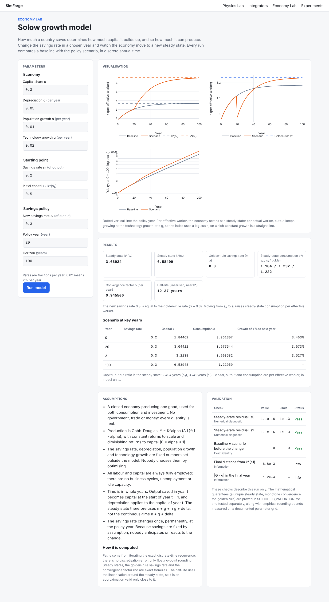
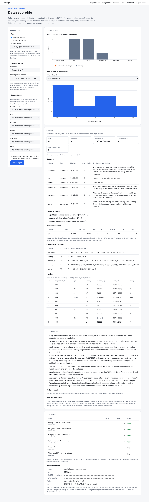

# SimForge

**Interactive simulation and quantitative research, built so the results can be checked.**

Every SimForge model states its assumptions and units, validates its inputs, records how
each run was produced, and is tested against analytical results wherever they exist.


| Module | Status | Scope |
|---|---|---|
| **Physics Lab** | Projectile model and integrator convergence study | Motion, collisions, energy transfer, orbital mechanics. Numerical results compared with theory. |
| **Economy Lab** | Solow growth model with a savings-policy experiment | Growth, then interest rates, taxes, spending and supply shocks, and their effect on inflation, output and unemployment. |
| **Quant Research Lab** | CSV import and dataset profile | Data import and exploration, then regression, hypothesis tests, time series, backtesting and overfitting checks. |

## What works today

The projectile model (2-D motion under gravity with linear drag `F = −bv`) solves each problem
**twice**: once with the exact closed-form solution and once with an adaptive Runge-Kutta
integrator (SciPy `solve_ivp`). It then reports how far apart the two are:

- error in flight time, range, maximum height and impact speed;
- maximum position error at the solver's own steps;
- an energy-balance residual (`KE + PE + work against drag` should be constant), an
  invariant the solver is never told about.

With default settings the two agree to about 1e-11 m.

Like every model page, the projectile and integrator pages use the shared workspace:
Parameters, Visualisation, Results, Assumptions and **Validation**, where the comparison with
the exact solution (or, for the integrator study, the pre-declared fit rule and every run's
inclusion decision) is shown.

**Range against launch angle.** After a simulation, sweep the launch angle from 0° to 90° and
find the angle that throws furthest. Without drag, from ground level, that's 45°. Drag pulls it
lower: about 30° for the default `b = 1 kg/s`. The result is compared with the closed-form
vacuum optimum.

**Integrator convergence study** (`/physics/projectile/integrators`). Forward Euler, classical
RK4 and velocity Verlet, written from scratch, solve the same problem over a range of fixed
time steps. A log-log plot shows the error falling as hᵖ. Orders are fitted only over step
sizes that pass a pre-declared rule (stable, asymptotic, above round-off). Observed orders on
the default case: 1.009, 4.027 and 2.000, against theoretical 1, 4 and 2.

**Solow growth model** (`/economy/solow`, the first Economy Lab model). Capital
accumulation in discrete annual time with Cobb-Douglas production and growing labour and
technology. Change the savings rate in a chosen year and compare the scenario with the
baseline: capital and consumption per effective worker, output per actual worker, steady
states, the golden-rule savings rate (α) and the speed of convergence. The page uses the shared
workspace layout (Parameters, Visualisation, Results, Assumptions, Validation), and each run
reports its own numerical checks.



**Dataset profile** (`/quant/datasets`, the first Quant Research Lab feature). Upload a CSV
file (UTF-8, at most 2 MiB and 50,000 rows) or use a bundled synthetic sample, and see what
is actually in it: row and column counts, inferred column types (with the reason for each,
and the option to override), missing values and how they were written, exact duplicate rows,
descriptive statistics for numeric, categorical and date columns, a preview and two charts.
Malformed files are rejected with row and line numbers, never repaired silently. The file
is used for that one request and not stored; saving a run to the experiment log (opt-in)
keeps only the file's SHA-256, its size, the settings (including any missing-value markers you
typed) and a few counts.



**Experiment log and replay** (`/experiments`). Every saved run from all three labs, newest
first and filterable by lab, each with a one-line result written by its model. Open a run to
load its inputs back into its page, give it a name and a note, or replay it.
Saved runs record their inputs, versions, the git commit and a SHA-256 fingerprint of the
outputs. `POST /api/v1/experiments/{run_id}/replay` reruns one and says whether the same
answer came back: **identical** (bit for bit), **within tolerance** (each model declares how
far each stored value may move, and why) or **differs**. A dataset profile of an uploaded file
is replayed by sending the same file again; its SHA-256 is checked before it is read.

Details, measured results and caveats are in [SCIENTIFIC_VALIDATION.md](SCIENTIFIC_VALIDATION.md).

**Learning guides.** [docs/LEARNING_GUIDE.md](docs/LEARNING_GUIDE.md) covers the Physics Lab
and the shared engineering; [docs/ECONOMY_LEARNING_GUIDE.md](docs/ECONOMY_LEARNING_GUIDE.md)
covers the Economy Lab; [docs/QUANT_LEARNING_GUIDE.md](docs/QUANT_LEARNING_GUIDE.md) covers
the Quant Research Lab.

## Quick start (macOS or Linux)

Prerequisites: [uv](https://docs.astral.sh/uv/) (`brew install uv`) and Node.js 20.9+
(`brew install node@22`). uv installs the right Python version automatically.

```bash
make setup     # install backend + frontend dependencies from lockfiles
make dev       # API on http://127.0.0.1:8000, app on http://localhost:3000
```

Then open http://localhost:3000. Interactive API docs are at http://127.0.0.1:8000/docs.

Without `make`, use `./scripts/setup.sh` and `./scripts/dev.sh`. In the cloud, open the repo
in GitHub Codespaces or any devcontainer host; `.devcontainer/` runs setup automatically.
In Claude Code cloud sessions, `.claude/hooks/session-start.sh` installs the dependencies at
startup the same way CI does; `.claude/skills/` holds the project's Claude Code skills
(sources in `.claude/skills/SOURCES.md`).

Configuration is optional. See [.env.example](.env.example); no secrets are required.

## Checks

```bash
make check     # everything CI runs, except end-to-end tests
make e2e       # also run Playwright tests (starts both servers)
```

| Layer | Tools |
|---|---|
| Backend | ruff (lint + format), mypy `--strict`, pytest with coverage |
| Contract | OpenAPI → TypeScript types regenerated and diffed |
| Frontend | ESLint, Prettier, `tsc`, Vitest + Testing Library, `next build` |
| End-to-end | Playwright: browser → Next.js → FastAPI → NumPy/SciPy → SQLite |

After changing a backend schema, run `make api-types` and commit the regenerated files.

## Project layout

```
backend/    FastAPI + NumPy/SciPy. Scientific code in src/simforge/<lab>/<model>/ is pure.
frontend/   Next.js + TypeScript + Plotly. API types generated from the backend schema.
scripts/    setup, dev and check scripts (CI runs the same steps)
```

Design decisions are explained in [ARCHITECTURE.md](ARCHITECTURE.md). The plan for all three
labs is in [ROADMAP.md](ROADMAP.md). An additional, IB-aligned **Foundations** track of simpler simulations
is planned alongside it, without changing that roadmap: see
[docs/IB_FOUNDATIONS.md](docs/IB_FOUNDATIONS.md).

## Engineering standards

- No approximation is presented as an exact result. Every number is labelled by how it was
  obtained.
- Inputs are validated at the boundary. Non-finite values are rejected.
- Tests use independent references (textbook formulas, limits, invariants, 50-digit
  evaluations), never the code's own output.
- Runs record their input hash and library versions so they can be reproduced.
