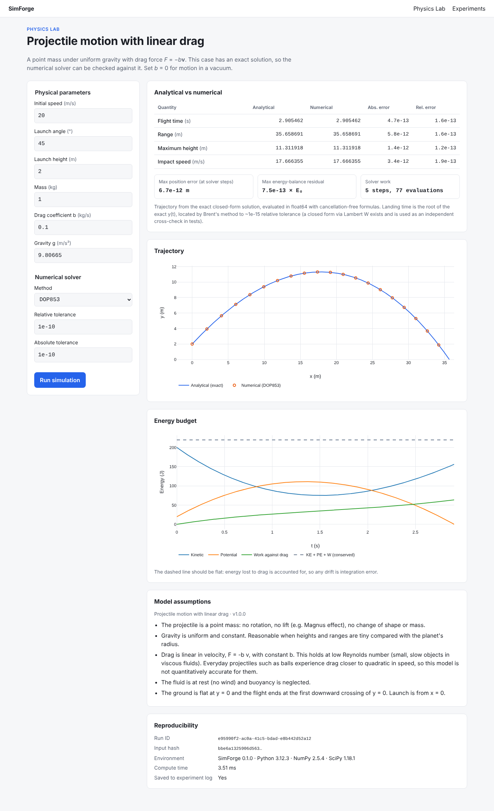

# SimForge

**Interactive simulation and quantitative research, built so the results can be checked.**

Every SimForge model states its assumptions and units, validates its inputs, records how
each run was produced, and is tested against analytical results wherever they exist.



| Module | Status | Scope |
|---|---|---|
| **Physics Lab** | Projectile model available | Motion, collisions, energy transfer, orbital mechanics. Numerical results compared with theory. |
| **Economy Lab** | Planned | Interest rates, taxes, spending and supply shocks, and their effect on inflation, output and unemployment. |
| **Quant Research Lab** | Planned | CSV import, regression, hypothesis tests, uncertainty, reproducible experiments. |

## What works today

The projectile model (2-D motion under gravity with linear drag `F = −bv`) solves each problem
**twice**: once with the exact closed-form solution and once with an adaptive Runge-Kutta
integrator (SciPy `solve_ivp`). It then reports how far apart the two are:

- error in flight time, range, maximum height and impact speed;
- maximum position error at the solver's own steps;
- an energy-balance residual (`KE + PE + work against drag` should be constant), an
  invariant the solver is never told about.

With default settings the two agree to about 1e-11 m. Details and caveats are in
[SCIENTIFIC_VALIDATION.md](SCIENTIFIC_VALIDATION.md).

## Quick start (macOS or Linux)

Prerequisites: [uv](https://docs.astral.sh/uv/) (`brew install uv`) and Node.js 20.9+
(`brew install node@22`). uv installs the right Python version automatically.

```bash
make setup     # install backend + frontend dependencies from lockfiles
make dev       # API on http://127.0.0.1:8000, app on http://localhost:3000
```

Then open http://localhost:3000. Interactive API docs are at http://127.0.0.1:8000/docs.

Without `make`, use `./scripts/setup.sh` and `./scripts/dev.sh`. In the cloud, open the repo
in GitHub Codespaces or any devcontainer host; `.devcontainer/` runs setup automatically.

Configuration is optional. See [.env.example](.env.example); no secrets are required.

## Checks

```bash
make check     # everything CI runs, except end-to-end tests
make e2e       # also run Playwright tests (starts both servers)
```

| Layer | Tools |
|---|---|
| Backend | ruff (lint + format), mypy `--strict`, pytest with coverage |
| Contract | OpenAPI → TypeScript types regenerated and diffed |
| Frontend | ESLint, Prettier, `tsc`, Vitest + Testing Library, `next build` |
| End-to-end | Playwright: browser → Next.js → FastAPI → SciPy → SQLite |

After changing a backend schema, run `make api-types` and commit the regenerated files.

## Project layout

```
backend/    FastAPI + NumPy/SciPy. Scientific code in src/simforge/<lab>/<model>/ is pure.
frontend/   Next.js + TypeScript + Plotly. API types generated from the backend schema.
scripts/    setup, dev and check scripts (CI runs the same steps)
```

Design decisions are explained in [ARCHITECTURE.md](ARCHITECTURE.md). The plan for the next
milestones is in [ROADMAP.md](ROADMAP.md).

## Engineering standards

- No approximation is presented as an exact result. Every number is labelled by how it was
  obtained.
- Inputs are validated at the boundary. Non-finite values are rejected.
- Tests use independent references (textbook formulas, limits, invariants, 50-digit
  evaluations), never the code's own output.
- Runs record their input hash and library versions so they can be reproduced.
